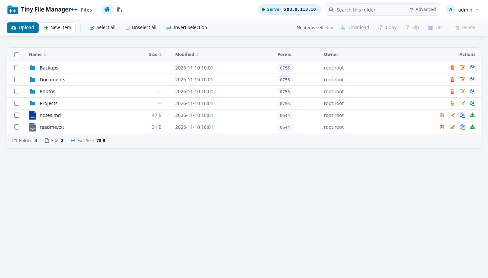
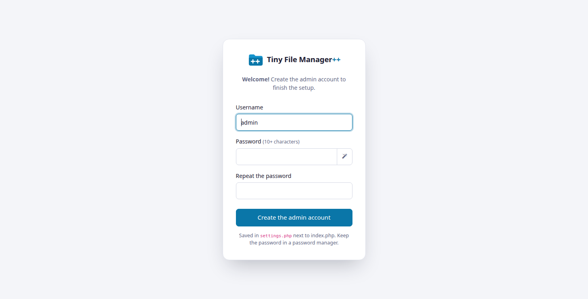
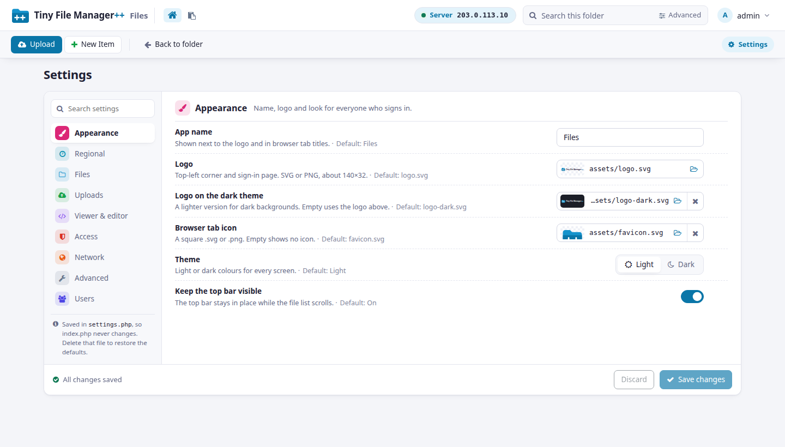
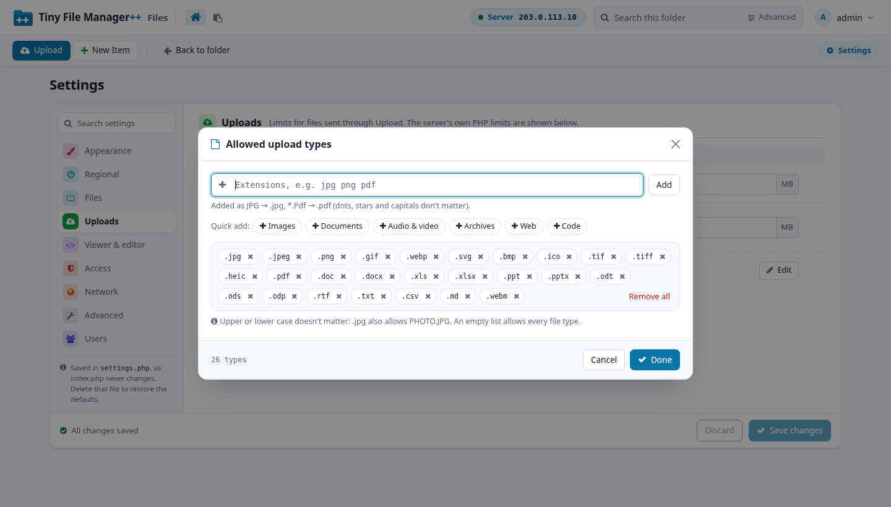
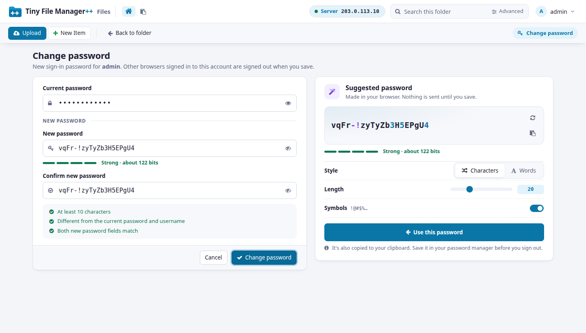
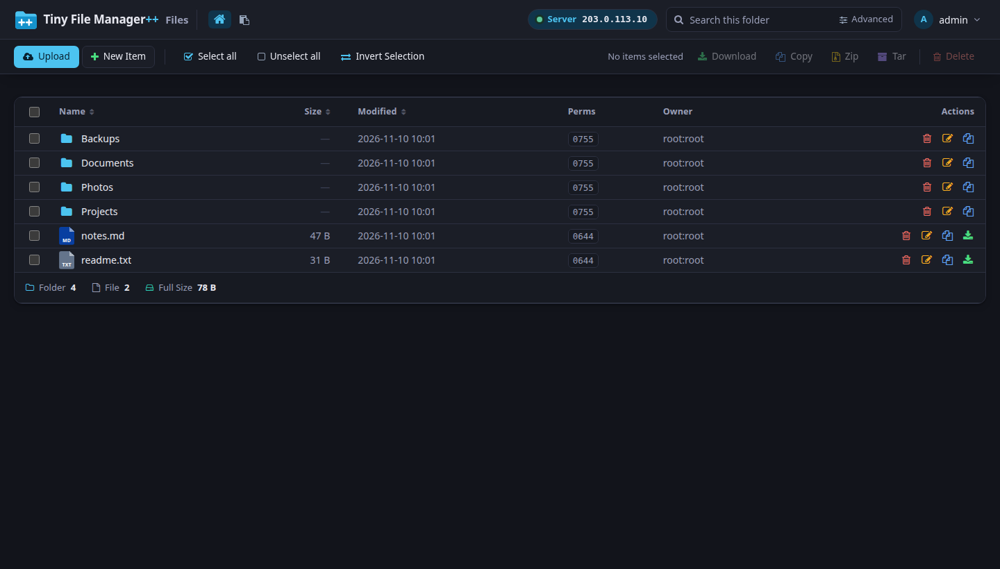
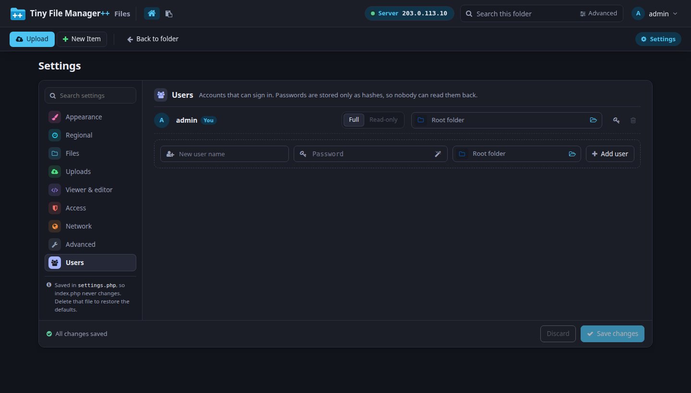

# Tiny File Manager++

A web file manager in a **single PHP file**, rebuilt on top of [Tiny File Manager](https://github.com/prasathmani/tinyfilemanager) with a new interface, a full settings page and safer defaults.

Drop `tinyfilemanager.php` on a PHP server, open it, create the admin account and manage files. Everything else — settings, users, passwords — is done from the browser and saved in a small `settings.php` next to it. `tinyfilemanager.php` itself never changes.



## What's new compared with Tiny File Manager

**Interface**
- New light and dark theme, coloured icons and a compact layout that fits on one screen.
- **Download** several files and folders as one zip, with a "Preparing download…" spinner.
- Copy / move with a folder picker, styled dialogs, a better file view and editor page.

**Settings page — no more editing PHP**
- Every option from the top of the file, in side tabs: Appearance, Regional, Files, Uploads, Viewer & editor, Access, Network, Advanced and **Users**.
- Each row shows its default, marks what you changed and can reset it; search across all tabs.
- No typing of paths or lists: folders and images are picked with a server browser, IP lists, file types, hidden items and editor languages have their own editors with validation and quick-add groups.
- Users: add and remove, read-only or full access, an own starting folder per user, passwords with a generator.

**Security**
- **First-run setup** instead of a built-in default password: the first visit creates the admin account.
- Change password page with a strength meter and generator; other sessions are signed out when a password changes.
- Hidden items are enforced everywhere: nothing inside a hidden folder can be listed, opened, downloaded, renamed, deleted, copied or searched, even by a direct link. Patterns (`*.log`, `backup*`) and full paths work, in any case.
- The app's own `settings.php` (password hashes) can never be shown or downloaded through the app.
- Guards against locking yourself out (IP rules that would block you, removing your own account, read-only for everyone).

**Server tools** (optional, off by default)
- An **Environment** page: OS, CPU, memory, disks, web server and PHP, services and Docker containers, network ports, security (updates, firewall, fail2ban, SSH), processes.
- **Scheduled jobs**: cron jobs and systemd timers with readable schedules, next and last run; disable, enable or delete cron jobs (a backup is kept).
- **Logs**: system journal, `/var/log`, web server, PHP, databases and Docker containers — last N lines or last N hours, errors only, search, copy and download.

**Deployment**
- One file: default images are built in, an older `config.php` is migrated automatically.
- `TFMPP_SETTINGS` can put `settings.php` anywhere, e.g. outside the web root or in a Docker volume.

## Screenshots

| | |
|---|---|
|  |  |
|  |  |
|  |  |

## Requirements

- PHP **7.2 or newer** (tested on 8.3) with the `session`, `json` and `fileinfo` extensions.
- `zip` for zip archives and the zip download; `phar` for tar archives.
- Server tools only: `shell_exec` allowed, and a Linux server. Viewing cron files, logs and switching jobs needs the PHP user to have the rights for them.

## Install

1. Copy `tinyfilemanager.php` to your web server (rename it to `index.php` if you like).
2. Open it in the browser and create the admin account.
3. Open the account menu (top right) → **Settings** to adjust everything else.

The folder next to the file must be writable by PHP so `settings.php` can be saved. To keep `settings.php` somewhere else, set the environment variable `TFMPP_SETTINGS` to its full path.

By default the root folder is the web server's document root. Change it under Settings → Files → Root folder.

### Docker

```bash
docker compose up -d        # then open http://localhost:8080
```

Files go in `./data`, and `./tfm-config/settings.php` keeps users and settings across rebuilds (see `docker-compose.yml`).

## Upgrading from Tiny File Manager

- Users in `$auth_users` keep working. Change passwords from the account menu and they move to `settings.php`.
- A `config.php` next to the file is folded into `settings.php` on the first visit and renamed to `config.php.migrated-<date>`.
- Everything set at the top of the PHP file still works as the default; values saved on the Settings page override it.

To return to the defaults, delete `settings.php` (this also removes users created on the Settings page).

## Security notes

- Use HTTPS, and keep the root folder as narrow as possible. `/` gives every full-access user the whole server.
- Leave **Server tools** off unless every full-access user may see and change the system.
- Keep **Show PHP errors** off in production; error messages can reveal paths.
- Report vulnerabilities privately, see [SECURITY.md](SECURITY.md).

## Language

The new screens are in English. Translations from `translation.json` still apply to the parts of the interface that come from Tiny File Manager.

## Credits and license

Tiny File Manager++ is a fork of **[Tiny File Manager](https://github.com/prasathmani/tinyfilemanager)** by Prasath Mani / CCP Programmers, and is released under the same license, the **GNU General Public License v3.0** — see [LICENSE](LICENSE).

It uses [Bootstrap](https://getbootstrap.com), [jQuery](https://jquery.com), [Font Awesome 4](https://fontawesome.com/v4), [Ace editor](https://ace.c9.io), [highlight.js](https://highlightjs.org), [Dropzone](https://www.dropzone.dev) and [DataTables](https://datatables.net), loaded from public CDNs.
